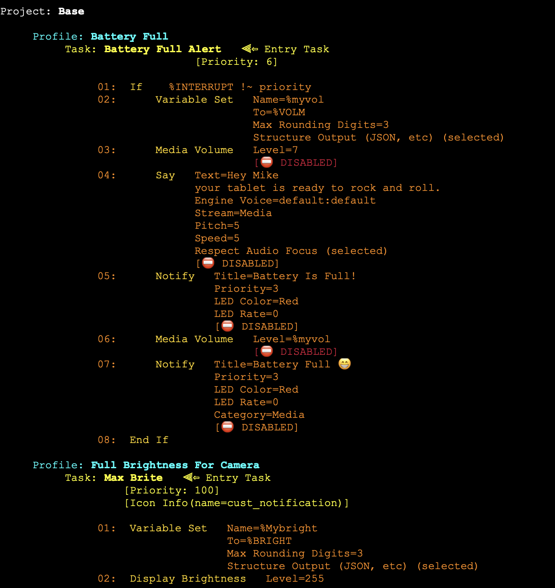
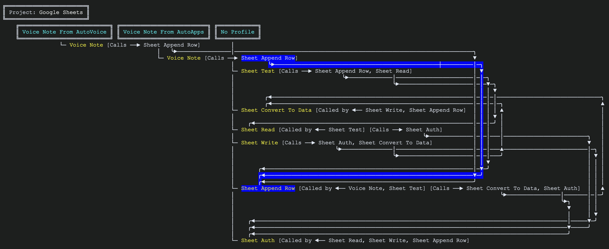

<p align="center">
  <picture>
    <source media="(prefers-color-scheme: dark)" srcset="../documentation_images/maptasker_logo_dark.png">
    
  </picture>
</p>

<div align="center">


[](https://sourcery.ai)
[](https://github.com/astral-sh/ruff)
[](https://docs.pytest.org/)
[](https://www.buymeacoffee.com/mctinker)

</div>

<p align="center">
  <b>Read this in:</b>
  <a href="../README.md">English</a> •
  <a href="README.zh-CN.md">简体中文</a> •
  <a href="README.es.md">Español</a> •
  <a href="README.hi.md">हिन्दी</a> •
  <a href="README.fr.md">Français</a> •
  <a href="README.ar.md">العربية</a> •
  <a href="README.de.md">Deutsch</a> •
  <a href="README.da.md">Dansk</a> •
  <a href="README.fi.md">Suomi</a> •
  <a href="README.ru.md">Русский</a> •
  <a href="README.ko.md">한국어</a> •
  <a href="README.ja.md">日本語</a>
</p>

---

<div dir="rtl" align="right">

# MapTasker

> هذه الترجمة تم إنشاؤها تلقائيًا. في حال وجود أي اختلاف، يُعتمد [الملف الأصلي README بالإنجليزية](../README.md).

## عرض/تحرير/تحليل مشاريع (Projects) وملفات تعريف (Profiles) ومهام (Tasks) ومشاهد (Scenes) تطبيق Tasker في متصفح سطح المكتب لديك (Mac/Windows 11/Linux)، بالاعتماد على ملف النسخ الاحتياطي أو ملف XML المُصدَّر من Tasker

خريطة التكوين (Configuration Map)...


خريطة المخطط (Diagram Map)...


[[أمثلة إضافية]](<https://github.com/mctinker/Map-Tasker/wiki#sample-output>)

هذا تطبيق مُكمِّل لتطبيق [Tasker](https://tasker.joaoapps.com/)، ومُصمَّم للعمل داخل متصفح الويب (انظر [الملاحظة 1](#1)).

لاحظت أن مشاريع وملفات تعريف ومهام ومشاهد Tasker الخاصة بي أصبحت صعبة الإدارة، وأن شاشة هاتفي كانت صغيرة جدًا للتنقل بينها بسهولة. لذلك كتبت برنامج Python لإنشاء خريطة كاملة لتكوين Tasker بالكامل داخل متصفح الويب، بالاعتماد على ملف XML للنسخة الاحتياطية الذي حفظته على القرص الصلب لجهازي المكتبي.

وبمرور الوقت، طوّرت هذه الخريطة بإضافة العديد من الخيارات الإضافية، بما في ذلك إمكانية تحرير عناصر Tasker وتقديم تحليل متعمّق لتكوين Tasker.

يمكن تحميل ملف النسخة الاحتياطية لـ Tasker، أو أي ملف XML آخر مُصدَّر من Tasker، يدويًا إلى جهاز الكمبيوتر الخاص بك (PC/Mac/Linux) أو إلى التخزين السحابي، أو يمكن لهذا البرنامج استرجاعه مباشرة من جهاز Android الخاص بك (انظر [الملاحظة 2](#2)).

## الميزات

- يمكنك اختيار مستوى التفاصيل المطلوب في المخرجات، بدءًا من نظرة عامة مختصرة وصولًا إلى مستوى تفصيلي للغاية لتهيئة النظام الخاص بك.
- اعرض مشروعًا أو ملف تعريف أو مهمة واحدة فقط.
- تضمين/استبعاد شروط الملف الشخصي والمهام: مثل الحالات والأحداث، إلخ.
- ما عليك سوى بث كل شيء أو تنسيق المخرجات لجعلها تبدو "أنيقة" عن طريق محاذاة جميع الحقول.
- غيّر المظهر: اختر بين الوضع "الرمادي الفاتح" أو "الرمادي الداكن".
- أخرج النتائج باستخدام الخط الموحد الذي تفضله، وقم بتسليط الضوء على أسماء المشاريع والملفات والمهام عن طريق كتابتها بخط مائل أو غامق أو بخط عريض أو خط تحته.
- عدّل الألوان المرتبطة بالجوانب المختلفة للناتج، بما يتناسب مع مزاجك.
- تضمين أوصاف TaskerNet وتفضيلات المستخدم.
- بالنسبة للتكوينات المعقدة، يمكن إضافة قاموس اختياري للروابط السريعة إلى مشاريعك، وملفات التعريف، والمهام، والمشاهد.
- اعرض مخططًا يوضح إعدادات Tasker بالكامل، بالإضافة إلى مخطط سير العمل.
- واجهة سطر الأوامر أو واجهة رسومية.
- استخدم ملف XML الذي تم تصديره، أو استرجع ملف XML مباشرةً من جهاز Android الخاص بك لعمل عملية ربط الإعدادات.
- أرسل المشاريع، والملفات الشخصية، والمهام، والمشاهد مرة أخرى إلى تطبيق Tasker على جهاز Android الخاص بك.
- احفظ وإعادة استعادة إعدادات التشغيل.
- حدد المهام التي تحتوي على عدد كبير جدًا من "الإجراءات"، والتي يجب تقسيمها إلى مهام متعددة.
- خيار تحليل (Ai Analysis) لتحليل مشروع أو ملف تعريف أو مهمة أو مشهد معين باستخدام نماذج ChatGPT/Claude/Gemini التي تعتمد على الخادم، أو نماذج Llama التي تعمل محليًا (عبر Ollama).
- عرض النتائج مباشرة داخل واجهة المستخدم الرسومية: (التكوين) عرض الخريطة، وعرض الشجرة، وعرض المخطط.
- اكتشاف التحديثات تلقائيًا، وإمكانية تثبيت الإصدارات الجديدة اختياريًا.
- بحث مُحسّن ووظيفة "البحث والاستبدال" المنظمة.
- أضف وقم بتحرير المشاريع، والملفات الشخصية، والمهام، والمشاهد (انظر [ملاحظة 6](#6))
- قائمة التغييرات التي حدثت منذ تاريخ محدد.
- حلل صحة ملف XML الخاص بـ "Tasker"، بالإضافة إلى العديد من المتغيرات الموجودة في الإعدادات.
- قارن ملف XML مع ملف XML الذي تم تحميله.
- تحقق من TaskerNet للحصول على آخر التحديثات للمشاريع والملفات والمهام، وقم بتطبيقها إذا كانت متاحة.
- استيراد كائن Tasker من ملف XML آخر، بالإضافة إلى جميع تبعياته.
- قم بإجراء تحليل للاتجاهات لمعرفة ما إذا كان الكود الخاص بك يتحسن (أو لا).
- قم بعمل قائمة بكل ما يستخدمه مهمة "Task" خارج جهاز Android.
- حدد "ما الذي يتم تنشيطه" بناءً على شرط معين (حالة أو حدث).
- افهم منطق المهمة، وقارن بين نتائج تنفيذها المختلفة.
- قم بتشغيل مراقب مباشر على جهاز Android لمعرفة أي الملفات والمهام التي يتم تشغيلها.
- حدد ما الذي يستهلك طاقة البطارية بشكل كبير.

## متطلبات البرنامج

### - Python الإصدار 3.11 أو أحدث

### - ملف Tasker XML كامل أو جزئي: backup.xml أو أي ملف XML آخر مُصدَّر من Tasker

&nbsp;&nbsp;&nbsp;سيُطلب منك تحديد ملف XML المُصدَّر من Tasker (مثل backup.xml) على سطح مكتبك، والذي تم إنشاؤه بواسطة Tasker الإصدار 5 أو الإصدار 6. اختياريًا، يمكنك استرجاعه مباشرة من جهاز Android الخاص بك (انظر [الملاحظة 2](#2)).

### - التحليل بالذكاء الاصطناعي

&nbsp;&nbsp;&nbsp;يتطلب هذا مفتاح API صالحًا في حال استخدام التحليل المستند إلى خادم، و/أو تثبيت Ollama للتحليل المحلي (انظر [الملاحظة 3](#3)).

## التثبيت

سيستغرق هذا البرنامج وجميع متطلباته الأساسية حوالي 230 ميجابايت من المساحة. يُوصى بتثبيته في بيئة افتراضية (الخيار 2).

1- لتثبيت MapTasker، أدخل أحد الأوامر التالية في الطرفية/نافذة الأوامر:

     ```python -m pip install maptasker -U```
                 ...أو...
     ```uv add maptasker```

2- لتثبيته في بيئة افتراضية، أدخل الأمر التالي في الطرفية/موجه الأوامر:

  عبر pip...
  - `cd xxx`، حيث 'xxx' هو المجلد الذي تريد إنشاء البيئة الافتراضية فيه.
  - `python -m venv venv`
  - فعّل البيئة الافتراضية...
    MAC/Linux: `source {directory path to 'xxx'}/venv/bin/activate`
    Windows: `venv\Scripts\activate`
  - `pip install maptasker`

  ...أو...

  عبر uv...
  - `cd xxx`، حيث 'xxx' هو المجلد الذي تريد إنشاء البيئة الافتراضية فيه.
  - `uv venv`
  - فعّل البيئة الافتراضية...
    MAC/Linux: `source {directory path to 'xxx'}/venv/bin/activate`
    Windows: `venv\Scripts\activate`
  - `uv pip install maptasker`

- تتطلب ميزات التحليل بالذكاء الاصطناعي مكتبات إضافية (OpenAI وAnthropic وGoogle وOllama). لا يقوم MapTasker بتثبيتها نيابةً عنك؛ إذا كنت تريدها، فثبِّت MapTasker مع الإضافة `ai` بدلًا من ذلك:

     ```python -m pip install "maptasker[ai]" -U```
                 ...أو...
     ```uv add "maptasker[ai]"```

## الاستخدام

- أدخل الأمر:

     ```maptasker```
     ...أو إذا كنت تستخدم uv لإدارة البيئة الافتراضية...
     ```uv run maptasker```

### التقارير من سطر الأوامر

تعمل ميزات Health Check وCompare وChanges Since وExport ومراقبة المجلد (watch) دون أي نافذة، مما يسمح بفحص نسخة احتياطية ليلية لـ Tasker تلقائيًا (من `cron` أو جدولة المهام أو `launchd` أو مهمة CI):

```
maptasker -healthcheck -file backup.xml                 # مشاكل في نسخة احتياطية
maptasker -compare older.xml newer.xml                  # الفرق بين نسختين احتياطيتين
maptasker -changes_since week -file backup.xml          # ما الذي تغيّر: today (اليوم)، week (الأسبوع)، month (الشهر)، all (الكل)، تاريخ معيّن، أو 3d (3 أيام)
maptasker -export map -format md -file backup.xml       # تصدير الخريطة (أو المخطط) بصيغة md أو json أو pdf
maptasker -watch ~/TaskerBackups                        # تسجيل كل نسخة احتياطية جديدة في السجل التاريخي
```

- **`-file`** يقبل نسخة احتياطية، أو مجلدًا (يُستخدم فيه أحدث ملف `.xml`). يحدد `-outdir` مكان كتابة الملفات، ويقوم `-save` أيضًا بحفظ التقرير كملف، تمامًا كما تفعل النافذة.
- **يُرسَل التقرير فقط، وليس أي شيء آخر، إلى المخرجات القياسية (standard output)**؛ ويُرسَل كل شيء آخر إلى مخرجات الخطأ القياسية، لذا فإن `maptasker -healthcheck -file backup.xml > report.txt` يُنتج تقريرًا نظيفًا.
- **رموز الخروج (Exit codes)** تتيح لأي سكريبت التصرف بناءً على النتيجة:

  | الرمز | المعنى |
  |---|---|
  | 0 | تم الانتهاء، ولم يكن هناك ما يُستدعي الإبلاغ عنه |
  | 10 | وجد التقرير شيئًا: أخطاء Health Check (استخدم `-fail_on warning` لتضمين التحذيرات، أو `-fail_on never` لتجاهلها)، أو اختلافات |
  | 11 | لم يكن لدى `-changes_since` أي تكوين سابق للمقارنة معه (يبدأ التشغيل الأول السجل التاريخي) |
  | 1 | خطأ في البرنامج |
  | 2 | تعذّر كتابة ملف (بما في ذلك مجلد `-outdir` غير القابل للاستخدام)، أو تعذّر إنشاء المخرجات |
  | 3 | الملف ليس نسخة احتياطية صالحة لـ Tasker |
  | 5 | لم يتم العثور على المشروع أو ملف التعريف أو المهمة الفردية المطلوبة (`-project` أو `-profile` أو `-task`) |
  | 6 | لم يتم تقديم أي ملف، أو الملف أو المجلد غير موجود |
  | 7 | خيار غير صالح، مثل لون غير صحيح، أو قيمة `-fail_on` غير معروفة، أو مقارنة ملف بنفسه |
  | 8 | فشل الطلب إلى جهاز Android الذي يُشغِّل خادم Tasker |

- **السجل التاريخي.** يتم تسجيل كل نسخة احتياطية يتم تحميلها في سجل التكوين التاريخي، وهو ما تقرأه `-changes_since`. يسجّل `-watch FOLDER` كل نسخة احتياطية جديدة وكاملة تظهر في `FOLDER`، بحسب تاريخ الملف، بحيث يستمر السجل التاريخي في التحديث حتى في الأيام التي لا تفتح فيها MapTasker أبدًا؛ أما `-watch FOLDER -once` فيقوم بفحص واحد فقط، لمهمة مجدولة. يُحفظ السجل التاريخي في مجلد باسم `MapTasker_Timeline` داخل الدليل الذي يتم تشغيل MapTasker منه، لذا يجب على أي مهمة مجدولة استخدام `-history_dir` للإشارة إلى نفس المجلد الذي تستخدمه النافذة.
- **لا شيء آخر يتغيّر.** هذه التشغيلات لا تفتح متصفحًا مطلقًا ولا تُعيد كتابة الإعدادات التي تحتفظ بها النافذة مطلقًا.

## مخرجات البرنامج

يُنتج MapTasker عددًا من ملفات المخرجات، على سطح المكتب وعلى جهاز Android على حدٍّ سواء.

راجع [الويكي (wiki)](https://github.com/mctinker/Map-Tasker/wiki/Generated-Output) للحصول على قائمة كاملة بالمخرجات التي يُنتجها MapTasker.

## للمزيد: [[خيارات وقت التشغيل]](https://github.com/mctinker/Map-Tasker/wiki/Runtime-Options)&nbsp;&nbsp;&nbsp;[[أمثلة على خيارات وقت التشغيل]](https://github.com/mctinker/Map-Tasker/wiki/Sample-Runtime-Options)&nbsp;&nbsp;&nbsp;[[نموذج مخرجات]](https://github.com/mctinker/Map-Tasker/wiki#sample-output)

## بنية المشروع

نظرة سريعة على الملفات الرئيسية والغرض منها:

- `maptasker/`: يحتوي على كود التطبيق الأساسي.
  - `maptasker/src/`: الملفات المصدر الرئيسية للغة بايثون الخاصة ببرنامج MapTasker، وهي منظمة في وحدات فرعية حسب الطبقات.
    (يمكن للطبقة استيراد العناصر الموجودة فقط أسفلها؛ ويفرض نظام `lint-imports` ذلك).
    - `gui/`: نوافذ و مربعات الحوار ومُعالجات الأحداث الخاصة بـ NiceGUI.
    - `device/`: ما الذي يفعله تطبيق MapTasker على جهاز Android، من خلال خادم HTTP الخاص بـ Tasker.
    - `mapops/`: عمليات الاستبدال المجمّعة، وإعادة الهيكلة، والإصلاح، والاستعادة، وكتابة المستندات؛ بالإضافة إلى أدوات TaskerNet وأدوات الاستعداد.
    - `analysis/`: أسئلة للقراءة فقط، يتم طرحها على إعداد معين.
    - `mapgen/` و `edit/`: تحميل نسخة احتياطية وإنشاء الخريطة من خلالها، بالإضافة إلى أدوات التحرير الخاصة بالمهمة والملف الشخصي والمشروع والمشهد.
    - `core/`: حالة التشغيل، وجداول إجراءات Tasker، وأدوات المساعدة المشتركة.
    - `mapit.py`، `progargs.py`، `runcli.py`، `rungui.py`، `clireports.py`: نقاط الدخول.
  - `maptasker/assets/`: الموارد الثابتة مثل الأيقونات والصور والبيانات بتنسيق JSON التي تستخدمها التطبيق.
  - ملفات اللغة للترجمة: `maptasker/locale`.
- `documentation_images/`: الصور المستخدمة في هذا الملف ووثائق أخرى.
- `tools/`: الأدوات المستخدمة أثناء التطوير.
- `tests/`: يحتوي على نصوص الاختبار والملفات المرتبطة بها، وذلك لضمان جودة الكود.
- `maptasker/main.py`: نقطة الدخول التي تسبق أمر `maptasker`. من مستودع مطابق، قم بتشغيل `python -m maptasker.main`.
- ملف ترخيص MIT الخاص بالمشروع: `LICENSE`.
- `README.md`: هذا الملف.
- `Changelog.md`: سجل التغييرات التي تم إجراؤها في كل نسخة.
- `pyproject.toml`: بيانات المشروع وإعدادات نظام البناء.

## الترخيص

هذا المشروع مرخّص بموجب [ترخيص MIT](../LICENSE).

ترخيص MIT هو ترخيص برمجيات مجانية متسامح (permissive) نشأ في معهد ماساتشوستس للتكنولوجيا (MIT). ولكونه ترخيصًا متسامحًا، فإنه يفرض قيودًا محدودة جدًا على إعادة الاستخدام، ويتميّز بالتالي بتوافق عالٍ مع الترخيصات الأخرى.

باختصار، هذا يعني أنك حرّ في:

- **الاستخدام**: استخدام البرنامج لأي غرض (تجاري أو شخصي).
- **التعديل**: تعديل البرنامج.
- **التوزيع**: توزيع البرنامج الأصلي أو المعدَّل.
- **الترخيص الفرعي**: إصدار ترخيص فرعي للبرنامج.

يجب عليك:

- **تضمين حقوق النشر**: تضمين إشعار حقوق النشر الأصلي ونص الترخيص نفسه في أي جزء جوهري من البرنامج.

يُقدَّم البرنامج "كما هو"، دون أي ضمان من أي نوع. للحصول على النص الكامل للترخيص، يُرجى الرجوع إلى ملف [LICENSE](../LICENSE).

## استكشاف الأخطاء وإصلاحها والأسئلة الشائعة

**س: يبدو مخطط `MapTasker_Map.txt` غير مُحاذًى بشكل صحيح في برنامج "المفكرة" (Notepad) على Windows.**

ج: قد لا يتعامل برنامج المفكرة بشكل صحيح مع التباعد في هذا الملف.

يُنصح باستخدام محرر نصوص آخر مثل Notepad++ أو VS Code أو Typepad (وتعيينه كبرنامج افتراضي لملفات `.txt`). تأكّد من إيقاف خاصية "التفاف النص" (text-wrap) ومن استخدام خط أحادي التباعد.

**س: كيف أحصل على ملف Tasker XML مباشرة من جهاز Android الخاص بي؟**

ج: المتطلبات الأساسية:

1- أن يكون المتصفح وجهاز Android على نفس الشبكة المحلية.

2- فيما يلي نموذجان لمشاريع Tasker على جهاز Android المستهدف، وكلاهما يجب تثبيته مع تمكين جميع الملفات التعريفية:
  [مشروع "مثال خادم HTTP" لـ Tasker](https://shorturl.at/bwCD4)
  [مشروع "واجهة برمجة تطبيقات HTTP" لـ Tasker](https://shorturl.at/hlTj0)

يمكن العثور على مزيد من التفاصيل في القسم [الملاحظة 2](#2) من هذا المستند.

**س: روابط المخطط (connectors) غير مُحاذاة بشكل صحيح للأسماء المكتوبة بالصينية أو الكورية أو اليابانية.**

ج: هذه مشكلة معروفة مرتبطة بمقاييس الخطوط لهذه اللغات في مكتبة الرسم البياني.

**س: لماذا لا تتوفر بعض إجراءات المهام وحالات/أحداث ملفات التعريف للتحرير/الإضافة؟

ج: في بعض الحالات، تتطلب هذه الإجراءات أو الأحداث أو الحالات معلومات متوفرة فقط على Android و/أو داخل Tasker نفسه. والسماح بتحرير هذه العناصر سيؤدي إلى مهمة أو ملف تعريف غير مكتمل، مما يتسبب في فشل Tasker.

## ملاحظات

تفاصيل بعض النقاط المذكورة في قسم "استكشاف الأخطاء وإصلاحها والأسئلة الشائعة" محفوظة هنا لمزيد من السياق.

### 1
**خصائص خاصة بـ Windows 11:**

- يُدعَم Windows 11 فقط. لا تُدعَم أي إصدارات أقدم من Windows.
- لمشاكل عرض `MapTasker_Map.txt` في برنامج المفكرة، استخدم محرر نصوص بديل مثل Typepad وعيّنه كبرنامج افتراضي لملفات `.txt`.

### 2
**الاسترجاع المباشر لملف XML من Android:**

للحصول على ملف Tasker XML مباشرة:

- تأكد من أن كلا من جهاز الكمبيوتر والجهاز الذي يعمل بنظام Android متصلان بنفس الشبكة المحلية، وأن تطبيق Tasker قيد التشغيل.
- يجب تثبيت مشروع "مثال خادم HTTP" (https://shorturl.at/bwCD4) ومشروع "واجهة برمجة تطبيقات HTTP لـ Tasker" (https://shorturl.at/hlTj0) وتشغيلهما على جهاز Android، مع تشغيل الخادم. يرجى تشغيل مهمة "تحديث معلومات GD HTTP" وإدخال معرف Google Drive الخاص بك عند مطالبتك (مرة واحدة فقط).
  - ملاحظة: يوفر تطبيق MapTasker خيارًا لتثبيت "مثال خادم HTTP" نيابة عنك. يمكنك العثور على هذا الخيار ضمن لوحة "الحصول على بيانات XML من جهاز Android". ولكن، يجب أن يكون "واجهة برمجة تطبيقات HTTP لـ Tasker" مثبتًا مسبقًا حتى يعمل هذا الخيار.
- بمجرد استرجاعها، يتم حفظ ملف XML على سطح المكتب ولا تحتاج إلى استرجاعه بشكل متكرر إلا إذا تم تعديله.
- ستحتاج أيضًا إلى الموافقة على بعض ميزات MapTasker الأخرى على جهاز Android الخاص بك، وذلك لإتاحة استخدام هذه الميزات.

### 3
**دعم الذكاء الاصطناعي**

التحليل بالذكاء الاصطناعي متوفر فقط عبر الواجهة الرسومية. يمكنك تشغيل تحليل باستخدام مشروع أو ملف تعريف أو مهمة أو مشهد واحد فقط. الدعم متوفر للنماذج المستندة إلى خادم مثل OpenAi (ChatGPT) وGemini وAnthropic، بالإضافة إلى نماذج Llama المحلية.

تُدعَم النماذج المستندة إلى Llama عبر [Ollama](https://ollama.com/)، والذي يجب عليك تنزيله وتثبيته وتشغيله يدويًا مرة واحدة لإعداد الخادم على جهاز الكمبيوتر الخاص بك. سيقوم MapTasker بتحميل نماذج Llama ديناميكيًا نيابةً عنك إذا لم تكن محمَّلة بالفعل.

لا تُثبَّت وحدات دعم الذكاء الاصطناعي تلقائيًا عند تثبيت MapTasker. بل تُثبَّت ديناميكيًا عند أول استخدام لطلب الذكاء الاصطناعي المحدَّد. وبهذه الطريقة، إذا كنت لا تخطط لاستخدام الذكاء الاصطناعي، فلن تتحمّل هذا العبء الإضافي.

## تحذيرات تحرير وتحليل التطبيق
**تحذيرات تحرير وتحليل MapTasker**

راجع وثيقة [التحذيرات (Caveats)](https://github.com/mctinker/Map-Tasker/blob/Master/caveats.txt) للحصول على التفاصيل.

## قائمة المهام المستقبلية (بدون ترتيب معيّن)

- [x] فحص الجاهزية (Readiness Check)

- [x] دعم إضافات (plugins) إضافية

- [x] الاستيراد مع التبعيات (Import with Dependencies)

- [x] اختبارات المهام - تخزين ومقارنة جلسات المهام قبل وبعد إجراء تغييرات على المهام.

- [ ] إضافة تفضيلات Tasker المتبقية إلى الخريطة

- [x] Task Stepper: محاكاة "تشغيل تجريبي" لمهمة إجراءً بإجراء، مع إظهار فروع If وFor وGoto التي تُنفَّذ وقيمة كل متغيّر

- [x] Live Run Monitor: عرض بث مباشر لملفات التعريف والمهام التي تُشغَّل على الهاتف، وتمييزها في عرض المخطط

- [ ] دمج ثلاثي الاتجاه (Three-way merge) لنسختين احتياطيتين بالنسبة لسلف مشترك، يتم حله تعارضًا تلو الآخر، ويمكن التراجع عنه بخطوة واحدة

- [x] متتبع تحديثات TaskerNet: إشعارك عند نشر مؤلف مشاركة تستخدمها إصدارًا جديدًا، مع فرق (diff) للتغييرات

- [ ] مكتبة شخصية للمقتطفات (snippets): حفظ تسلسلات إجراءات ومهام وقوالب ملفات تعريف قابلة لإعادة الاستخدام، وإدراجها مع معاملات

- [x] إضافة/تعديل أوصاف المهام في TaskerNet.

- [ ] شروحات بلغة مبسّطة داخل الخريطة: ملخص سطر واحد لكل ملف تعريف ومهمة، مكتوب بالذكاء الاصطناعي، ومُخزَّن مؤقتًا، وقابل للتحرير

- [x] فاحص الموارد المفقودة: التحقق من أن الملفات والمجلدات والصور والأصوات والمشاهد والتطبيقات التي تشير إليها إجراءاتك ما زالت موجودة

- [x] لوحة معلومات التعقيد والاتجاهات: تتبّع طول المهام، والتداخل، وعمق سلسلة الاستدعاءات، والنتائج بمرور الوقت

- [ ] تصدير موقع وثائق: مجموعة مرتبطة من صفحات Markdown أو HTML، صفحة واحدة لكل مشروع وملف تعريف ومهمة ومشهد، مع مخططات الاستدعاء

- [x] مساعد إعادة تسمية المتغيرات ونطاقها: إعادة تسمية متغيّر، أو تحويل متغيّر عام إلى محلي، في كل مكان يُستخدم فيه، كخطوة تراجع واحدة

## بيان الخصوصية

لا يتم التقاط أي معلومات على الإطلاق وإرسالها عبر الشبكة إليّ أو إلى أي طرف ثالث آخر، باستثناء ما هو مدرج أدناه (حركة الشبكة).

عند الإبلاغ عن خطأ، سيُطلب منك على الأرجح تقديم ملف سجل المخرجات الخاص بالخطأ وملف XML الخاص بك، ويُستخدم كلاهما فقط لتصحيح أخطاء البرنامج ثم يُحذفان فورًا.

حركة الشبكة هي كما يلي:

- حركة الشبكة المحلية (LAN) عند استرجاع ملف XML مباشرة من جهاز Android الخاص بك.
- عند بدء التشغيل، مرة واحدة يوميًا، يتم التحقق من موقع pypi.com لتحديد ما إذا كان هناك إصدار جديد متاح.
- يتم تحديث البرنامج من pypi.com (عبر 'pip') إذا تم اختيار "Upgrade" في الواجهة الرسومية.
- تتم قراءة ملف 'Changelog.md' من '<https://github.com/mctinker/Map-Tasker>' إذا تم اختيار "What's New" في الواجهة الرسومية.
- يتم استخدام chatgpt.com عند استخدام التحليل بالذكاء الاصطناعي مع أي من نماذج OpenAi. يتم إرسال مخرجات MapTasker إلى الخادم عبر استدعاء API قياسي للتحليل. وينطبق الأمر نفسه على Claude (من Anthropic) وGemini (من Google).
- سيتم تحميل نماذج ذكاء اصطناعي محلية جديدة ومُحدَّثة من '<https://ollama.com/library>' عند تشغيل ميزة التحليل بالذكاء الاصطناعي.
- سيتم الوصول إلى روابط مصادر الصور والفيديو المُحدَّدة عبر وسم HTML '' في تسميات إجراءات المهام وأوصاف TaskerNet عند النقر عليها. أمثلة: imggur.com وYoutube وDropbox وGoogle Drive وغيرها.

## المساهمة

المساهمات مرحَّب بها! فيما يلي بعض الطرق التي يمكنك من خلالها المساهمة في MapTasker:

**الإبلاغ عن الأخطاء:**

- إذا وجدت خطأً، يُرجى فتح "issue" على [صفحة GitHub Issues](https://github.com/mctinker/Map-Tasker/issues).
- أدرج أكبر قدر ممكن من التفاصيل:
  - خطوات إعادة إنتاج الخطأ.
  - السلوك المتوقَّع والسلوك الفعلي.
  - نظام التشغيل وإصدار Python الخاصين بك.
  - إصدار MapTasker.
  - الأجزاء ذات الصلة من ملف Tasker XML الخاص بك (إن انطبق، ومع التأكد من عدم تضمين أي معلومات حساسة).
  - ملف `maptasker.log` إذا تم إنشاؤه باستخدام خيار `-debug`.

**اقتراح التحسينات:**

- افتح "issue" على GitHub، موضّحًا اقتراحك.
- اشرح حالة الاستخدام وسبب كون هذا التحسين مفيدًا.

**طلبات السحب (Pull Requests):**

- إذا كنت تريد المساهمة بالكود:
    1. قم بعمل Fork للمستودع.
    2. أنشئ فرعًا (branch) جديدًا لميزتك أو إصلاح الخطأ (مثل `feature/new-output-format` أو `fix/xml-parsing-error`).
    3. قم بإجراء تغييراتك.
    4. تأكّد من أن كودك يتوافق مع نمط الكود Black (كما هو مُشار إليه في الشعار).
    5. أضف اختبارات لتغييراتك في مجلد `tests/` إن انطبق ذلك.
    6. تأكّد من نجاح جميع الاختبارات.
    7. قدّم طلب سحب (pull request) إلى الفرع `Master`.

**نمط الكود:**

- يستخدم هذا المشروع [Ruff](https://docs.astral.sh/ruff/formatter/) لتنسيق الكود. يُرجى التأكد من أن مساهماتك منسَّقة باستخدام Ruff.

نقدّر مساعدتك في تحسين MapTasker!

## المشاكل المعروفة

- روابط المخطط غير مُحاذاة بشكل صحيح إذا كانت الأسماء بالصينية أو الكورية أو اليابانية.
- لا يُدعَم تحرير جميع إجراءات المهام وحالات/أحداث ملفات التعريف، لأن بعضها يتطلب معلومات متوفرة فقط على جهاز Android.

## المساهمات

[Taskometer](https://github.com/Taskomater/Tasker-XML-Info)

[©Connor Talbot 2021 لمشروع Clippy](https://github.com/con-dog/clippy)

[Ollama](https://ollama.com/)، [OpenAi](https://openai.com/)، [Claude AI](https://claude.ai)، [Gemini AI](https://gemini.google.com/)

[NiceGui](https://nicegui.io/)

[](https://www.buymeacoffee.com/mctinker)

</div>
