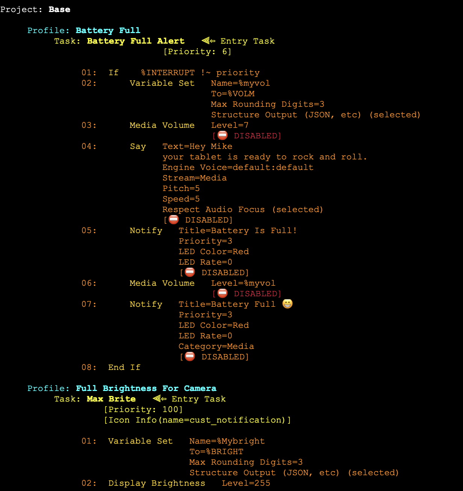
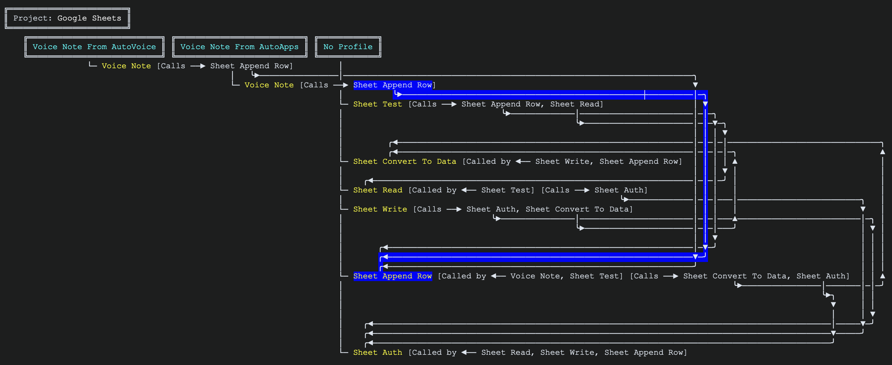

<p align="center">
  <picture>
    <source media="(prefers-color-scheme: dark)" srcset="../documentation_images/maptasker_logo_dark.png">
    
  </picture>
</p>

<div align="center">


[](https://sourcery.ai)
[](https://github.com/astral-sh/ruff)
[](https://docs.pytest.org/)
[](https://www.buymeacoffee.com/mctinker)

</div>

<p align="center">
  <b>Read this in:</b>
  <a href="../README.md">English</a> •
  <a href="README.zh-CN.md">简体中文</a> •
  <a href="README.es.md">Español</a> •
  <a href="README.hi.md">हिन्दी</a> •
  <a href="README.fr.md">Français</a> •
  <a href="README.ar.md">العربية</a> •
  <a href="README.de.md">Deutsch</a> •
  <a href="README.da.md">Dansk</a> •
  <a href="README.fi.md">Suomi</a> •
  <a href="README.ru.md">Русский</a> •
  <a href="README.ko.md">한국어</a> •
  <a href="README.ja.md">日本語</a>
</p>

---

# MapTasker

> Tämä käännös on luotu automaattisesti. Mahdollisten ristiriitojen tapauksessa alkuperäinen [englanninkielinen README](../README.md) on määräävä.

## Näytä, muokkaa ja analysoi Tasker-sovelluksen Project-, Profile-, Task- ja Scene-kohteita työpöytäselaimessasi (Mac/Windows 11/Linux) Taskerin varmuuskopio- tai viedyn XML-tiedoston pohjalta

Konfiguraatiokartta (Configuration Map)...


Kaaviokartta (Diagram Map)...


[[Lisää esimerkkejä]](<https://github.com/mctinker/Map-Tasker/wiki#sample-output>)

Tämä on [Tasker](https://tasker.joaoapps.com/)-sovellusta täydentävä ohjelma, joka on tarkoitettu käytettäväksi verkkoselaimessa (katso [huomautus 1](#1)).

Huomasin, että Tasker-projectini/-profileni/-taskini/-scenet olivat muuttuneet hallitsemattomiksi, ja puhelimeni näyttö oli liian pieni niiden selaamiseen. Niin kirjoitin Python-ohjelman, joka luo verkkoselaimeeni täydellisen kartan koko konfiguraatiostani sen Tasker-varmuuskopio-XML-tiedoston pohjalta, jonka olin tallentanut paikalliselle työpöytäasemalleni.

Ajan myötä olen kehittänyt karttaa lisäämällä monia ominaisuuksia, mukaan lukien mahdollisuuden muokata Tasker-objekteja ja saada syvällinen analyysi Tasker-konfiguraatiosta.

Taskerin varmuuskopio tai muu Taskerin viety XML voidaan joko latata manuaalisesti PC-/Mac-/Linux-/pilvilevylle, tai tämä ohjelma voi hakea sen suoraan Android-laitteestasi (katso [huomautus 2](#2)).

## Ominaisuudet

- Valitse tulosteen yksityiskohtaisuuden taso yleiskatsauksesta erittäin yksityiskohtaiseen tasoon konfiguraatiostasi.
- Näytä vain yksi Project, Profile tai Task.
- Sisällytä/jätä pois Profile- ja Task-ehdot: States, Events jne.
- Suoratoista kaikki yksinkertaisesti, tai tee tulosteesta "siisti" tasaamalla kaikki kentät.
- Muuta ulkoasua: valitse 'vaalea' tai 'tumma' tila.
- Tulosta haluamallasi tasalevyisellä fontilla, ja korosta Project-, Profile- ja Task-nimiä kursivoinnilla, lihavoinnilla, korostuksella ja/tai alleviivauksella.
- Muokkaa tulosteen eri osa-alueisiin liitettyjä värejä mielialasi mukaan.
- Sisällytä TaskerNet-kuvaukset ja/tai Tasker-asetukset (preferences).
- Monimutkaisia konfiguraatioita varten voit valinnaisesti sisällyttää hakemiston hyperlinkeistä Project-, Profile-, Task- ja Scene-kohteisiisi.
- Näytä kaavio koko Tasker-konfiguraatiostasi sekä Task Flow.
- Komentorivi- tai graafinen käyttöliittymä.
- Käytä vietyä XML:ää, tai hae XML suoraan Android-laitteestasi konfiguraatiokarttaa varten.
- Lähetä Project-, Profile-, Task- ja Scene-kohteita takaisin Taskeriin Android-laitteessasi.
- Tallenna ja palauta ajonaikaiset asetukset.
- Tunnista Taskit, joissa on liikaa "actions"-toimintoja ja jotka tulisi mahdollisesti jakaa useampaan Taskiin.
- AI-analyysivaihtoehto tietyn Project-, Profile-, Task- tai Scene-kohteen analysointiin käyttäen tuettuja palvelinpohjaisia ChatGPT-/Claude-/Gemini-malleja tai paikallisia Llama-malleja (Ollaman kautta).
- Näytä tulokset suoraan graafisessa käyttöliittymässä: (konfiguraation) Map-näkymä, Tree-näkymä ja Diagram-näkymä.
- Automaattinen päivitysten havaitseminen ja valinnainen uusien versioiden asennus.
- Parannettu haku ja jäsennelty 'Find/Replace'.
- Lisää ja muokkaa Project-, Profile-, Task- ja Scene-kohteita (katso [huomautus 6](#6)).
- Listaa muutokset tietystä päivämäärästä alkaen.
- Linkitä Project, Profile, Task tai Scene siihen TaskerNet-jakoon, josta se on peräisin, saa ilmoituksen, kun sen tekijä julkaisee uudemman version, ja ota tekijän muutokset käyttöön yksi kerrallaan.
- Analysoi Tasker-XML:n kunto sekä koko konfiguraatiossa olevat lukuisat muuttujat.
- Vertaa XML-tiedostoa ladattuun XML:ään.

## Ohjelman riippuvuudet

### - Python-versio 3.11 tai uudempi

### - Täydellinen tai osittainen Tasker-XML-tiedosto: backup.xml tai muu Taskerin viety XML-tiedosto

&nbsp;&nbsp;&nbsp;Sinua pyydetään paikantamaan ja valitsemaan Taskerin viemä XML-tiedosto (esim. backup.xml) työpöydältäsi, Taskerin version 5 tai version 6 luomana. Voit myös valinnaisesti hakea sen suoraan Android-laitteestasi (katso [huomautus 2](#2)).

### - AI-analyysi

&nbsp;&nbsp;&nbsp;Tämä vaatii voimassa olevan API-avaimen, jos käytät palvelinpohjaista analyysiä, ja/tai Ollaman asentamisen paikallista analyysiä varten (katso [huomautus 3](#3)).

## Asennus

Tämä ohjelma ja kaikki sen esivaatimukset vievät noin 230 Mt tilaa. Suositellaan asentamista virtuaaliympäristöön (vaihtoehto 2).

- Asenna MapTasker syöttämällä jompikumpi seuraavista komennoista Terminaaliin/Komentokehotteeseen:

     ```python -m pip install maptasker -U```
                 ...TAI...
     ```uv add maptasker```

- Asentaaksesi sen virtuaaliympäristöön, syötä seuraava komento Terminaaliin/komentokehotteeseen:

  pip:n kautta...
  - `cd xxx`, missä 'xxx' on hakemisto, johon haluat asettaa virtuaaliympäristön.
  - `python -m venv venv`
  - Aktivoi virtuaaliympäristö...
    MAC/Linux: `source {directory path to 'xxx'}/venv/bin/activate`
    Windows: `venv\Scripts\activate`
  - `pip install maptasker`

  ...tai...

  uv:n kautta...
  - `cd xxx`, missä 'xxx' on hakemisto, johon haluat asettaa virtuaaliympäristön.
  - `uv venv`
  - Aktivoi virtuaaliympäristö...
    MAC/Linux: `source {directory path to 'xxx'}/venv/bin/activate`
    Windows: `venv\Scripts\activate`
  - `uv pip install maptasker`

- AI-analyysiominaisuudet tarvitsevat ylimääräisiä kirjastoja (OpenAI, Anthropic, Google ja Ollama). MapTasker ei asenna niitä puolestasi; jos haluat ne, asenna MapTasker sen sijaan `ai`-lisäosan kanssa:

     ```python -m pip install "maptasker[ai]" -U```
                 ...TAI...
     ```uv add "maptasker[ai]"```

## Käyttö

- Syötä komento:

     ```maptasker```
     ...tai, jos käytät uv:tä virtuaaliympäristön hallintaan...
     ```uv run maptasker```

### Raportit komentorivilta

Health Check, Compare, Changes Since, Export ja kansion tarkkailu (watch) toimivat ilman ikkunaa, jolloin yöllinen Tasker-varmuuskopio voidaan tarkistaa automaattisesti (`cron`:sta, Tehtävien ajoittajasta, `launchd`:sta tai CI-työstä):

```
maptasker -healthcheck -file backup.xml                 # ongelmat varmuuskopiossa
maptasker -compare older.xml newer.xml                  # mikä eroaa kahden varmuuskopion välillä
maptasker -changes_since week -file backup.xml          # mikä on muuttunut: today (tänään), week (viikko), month (kuukausi), all (kaikki), päivämäärä, tai 3d (3 päivää)
maptasker -export map -format md -file backup.xml       # Map (tai diagrammi) muodossa md, json tai pdf
maptasker -watch ~/TaskerBackups                        # tallentaa jokaisen uuden varmuuskopion historiaan
```

- **`-file`** hyväksyy varmuuskopion tai kansion (uusinta `.xml`-tiedostoa käytetään). `-outdir` valitsee, minne tiedostot kirjoitetaan, ja `-save` tallentaa raportin myös tiedostona, kuten ikkuna tekee.
- **Vain raportti, ja ainoastaan raportti, menee vakiotulosteeseen (standard output)**; kaikki muu menee vakiovirhetulosteeseen, jolloin `maptasker -healthcheck -file backup.xml > report.txt` tuottaa siistin raportin.
- **Poistumiskoodit (Exit codes)** antavat skriptille mahdollisuuden toimia tuloksen perusteella:

  | Koodi | Merkitys |
  |---|---|
  | 0 | Valmis, ja raportoitavaa ei ollut |
  | 10 | Raportti löysi jotain: Health Check -virheitä (`-fail_on warning` sisällyttääksesi varoitukset, `-fail_on never` jättääksesi ne huomiotta), tai eroja |
  | 11 | `-changes_since`-komennolla ei ollut aiempaa konfiguraatiota vertailtavaksi (ensimmäinen ajo käynnistää historian) |
  | 1 | Ohjelmavirhe |
  | 2 | Tiedostoa ei voitu kirjoittaa (mukaan lukien `-outdir`-kansio, jota ei voida käyttää), tai tulostetta ei voitu luoda |
  | 3 | Tiedosto ei ole kelvollinen Tasker-varmuuskopio |
  | 5 | Pyydettyä yksittäistä Projectia, Profilea tai Taskia (`-project`, `-profile` tai `-task`) ei löytynyt |
  | 6 | Tiedostoa ei annettu, tai tiedostoa/kansiota ei ole olemassa |
  | 7 | Virheellinen valinta, kuten väärä väri, tuntematon `-fail_on`-arvo, tai tiedoston vertaaminen itseensä |
  | 8 | Pyyntö Tasker-palvelinta ajavalle Android-laitteelle epäonnistui |

- **Historia.** Jokainen ladattu varmuuskopio tallennetaan konfiguraatiohistoriaan, jota `-changes_since` lukee. `-watch FOLDER` tallentaa jokaisen uuden, täydellisen varmuuskopion, joka ilmestyy `FOLDER`-kansioon, tiedoston päivämäärän mukaan, jolloin historia täyttyy myös niinä päivinä, kun et koskaan avaa MapTaskeria; `-watch FOLDER -once` tarkistaa vain yhden kerran, ajoitettua työtä varten. Historia säilytetään `MapTasker_Timeline`-kansiossa siinä hakemistossa, josta MapTasker käynnistetään, niin ajoitetun työn tulisi käyttää `-history_dir`-valintaa osoittamaan samaan kansioon, jota ikkuna käyttää.
- **Mikään muu ei muutu.** Nämä ajot eivät koskaan avaa selainta, eivätkä koskaan kirjoita uudelleen asetuksia, joita ikkuna säilyttää.

## Ohjelman tulosteet

MapTasker tuottaa useita tulostetiedostoja, sekä työpöydälle että Android-laitteelle.

Katso [wiki](https://github.com/mctinker/Map-Tasker/wiki/Generated-Output) saadaksesi täydellisen luettelon MapTaskerin tuottamista tulosteista.

## Lisää: [[Ajonaikaiset asetukset]](https://github.com/mctinker/Map-Tasker/wiki/Runtime-Options)&nbsp;&nbsp;&nbsp;[[Esimerkkejä ajonaikaisista asetuksista]](https://github.com/mctinker/Map-Tasker/wiki/Sample-Runtime-Options)&nbsp;&nbsp;&nbsp;[[Esimerkkituloste]](https://github.com/mctinker/Map-Tasker/wiki#sample-output)

## Projektin rakenne

Lyhyt yleiskatsaus päätiedostoista ja niiden tarkoituksesta:

- `maptasker/`: Sisältää sovelluksen perusohjelmakoodin.
  - `maptasker/src/`: Pääasialliset Python-lähtekooditiedostot MapTaskerin logiikalle, jaettuna alipaketteihin kerroksittain.
    (yksi kerros voi tuoda vain alempana olevat; `lint-imports` varmistaa tämän):
    - `gui/`: NiceGUI:n ikkunat, dialogit ja niiden tapahtumankäsittelijät.
    - `device/`: Mitä MapTasker tekee Android-laitteella, käyttäen Taskerin HTTP-palvelua.
    - `mapops/`: massinen korvaaminen, uudelleenjärjestely, korjaaminen, palauttaminen ja suunnittelu; sekä TaskerNet- ja valmiusvälineet.
    - `analysis/`: kysymyksiä, jotka on asetuksen yhteydessä ja joihin vastauksia ei voida muuttaa.
    - `mapgen/` ja `edit/`: varmuuskopion lataaminen ja kartan rakentaminen sen pohjalta, sekä tehtävän, profiilin, projektin ja kohtauksen editointityökalut.
    - `core/`: tilanne, Tasker-toimintojen taulukot ja jaetut työkalut.
    - `mapit.py`, `progargs.py`, `runcli.py`, `rungui.py`, `clireports.py`: pääsykohteet.
  - `maptasker/assets/`: Staattiset resurssit, kuten ikoon, kuvat ja JSON-tiedot, joita sovellus käyttää.
  - `maptasker/locale`: kielilähteet käännösten tekemiseen.
- `documentation_images/`: Kuvia, jo käytetään tässä README-tiedostossa ja muussa dokumentaatiossa.
- `tools/`: kehityksen aikana käytetyt työkalut.
- `tests/`: Sisältää testausohjelmia ja niihin liittyviä tiedostoja, joilla varmistetaan koodin laatu.
- `maptasker/main.py`: Komennon `maptasker` taustalla oleva lähtökohta. Kloonatusta arkistosta käynnistä `python -m maptasker.main`.
- `LICENSE`: Projektille tarkoitettu MIT-lisenssitiedosto.
- `README.md`: Tämä tiedosto.
- `Changelog.md`: Muutosten kirjaus jokaisessa versiossa.
- `pyproject.toml`: Projektin metadatan ja rakennusjärjestelmän asetukset.

## Lisenssi

Tämä projekti on lisensoitu [MIT-lisenssin](../LICENSE) alaisena.

MIT-lisenssi on sallittu vapaan ohjelmiston lisenssi, joka on peräisin Massachusetts Institute of Technologysta (MIT). Sallittuna lisenssinä se asettaa vain hyvin rajoitetut rajoitukset uudelleenkäytölle, ja sillä on siksi korkea lisenssiyhteensopivuus.

Lyhyesti sanottuna tämä tarkoittaa, että saat vapaasti:

- **Käyttää**: Käyttää ohjelmistoa mihin tahansa tarkoitukseen (kommerciaaliseen tai yksityiseen).
- **Muokata**: Muokata ohjelmistoa.
- **Jakaa**: Jakaa alkuperäistä tai muokattua ohjelmistoa.
- **Alilisensoida**: Alilisensoida ohjelmiston.

Sinun täytyy:

- **Sisällyttää tekijänoikeus**: Sisällyttää alkuperäinen tekijänoikeusilmoitus ja itse lisenssi mihin tahansa olennaiseen osaan ohjelmistosta.

Ohjelmisto toimitetaan "SELLAISENAAN", ilman minkäänlaista takuuta. Täyden lisenssitekstin löydät tiedostosta [LICENSE](../LICENSE).

## Vianmääritys ja usein kysytyt kysymykset

**K: `MapTasker_Map.txt`-kaavio näyttää väärin kohdistetulta Windowsin Muistiossa (Notepad).**

V: Muistio ei välttämättä käsittele tämän tiedoston välejä oikein.

Suositellaan käyttämään toista tekstieditoria, kuten Notepad++:aa, VS Codea tai Typepadia (ja asettamaan se oletukseksi `.txt`-tiedostoille). Varmista, että 'tekstin rivitys' on pois päältä ja että käytössä on tasalevyinen fontti.

**K: Miten hankin Tasker-XML-tiedoston suoraan Android-laitteestani?**

V: Edellytykset:

1- Selaimen ja Android-laitteen on oltava samassa paikallisverkossa.

2- ['Http Server Example' -Tasker-projektin](https://shorturl.at/bwCD4) on oltava asennettuna ja aktiivisena Android-laitteessa, palvelimen käynnissä.

Lisätietoja löytyy tämän README-tiedoston "Huomautukset"-osiosta.

**K: Kaavion yhdysviivat ovat väärin kohdistettuja kiinan-, korean- tai japaninkielisten nimien kohdalla.**

V: Tämä on tunnettu ongelma, joka liittyy näiden kielten fonttimittoihin kaaviokirjastossa.

**K: Miksi joitakin Task-toimintoja (actions) ja Profile-tiloja/tapahtumia (states/events) ei voi muokata/lisätä?

V: Joissain tapauksissa näiden actions-, events- tai states-toimintojen vaatimat tiedot ovat saatavilla vain Androidilla ja/tai Taskerin sisällä. Näiden muokkaamisen sallimisesta seuraisi puutteellinen Task tai Profile, mikä aiheuttaisi Taskerin virhetoiminnan.

## Huomautukset

Yksityiskohdat joistakin kohdista, jotka mainittiin "Vianmääritys ja usein kysytyt kysymykset" -osiossa, on säilytetty tässä lisäkontekstia varten.

### 1
**Windows 11 -erityispiirteet:**

- Ainoastaan Windows 11 on tuettu. Mitkään aiemmat Windows-versiot eivät ole tuettuja.
- `MapTasker_Map.txt`:n näyttöongelmissa Muistiossa käytä vaihtoehtoista tekstieditoria, kuten Typepadia, ja aseta se oletukseksi `.txt`-tiedostoille.

### 2
**XML:n suora hakeminen Androidista:**

Hakeaksesi Tasker-XML-tiedoston suoraan:

- Varmista, että sekä työpöytä että Android-laite ovat samassa paikallisverkossa ja että Tasker on käynnissä.
- ['Http Server Example' -Tasker-projektin](https://shorturl.at/bwCD4) on oltava asennettuna ja aktiivisena Android-laitteessa, palvelimen käynnissä. Muista ajaa "Update GD HTTP Info" -Task ja (vain ensimmäisellä kerralla) syötä Google Drive -tunnuksesi, kun sitä pyydetään.
- Haun jälkeen XML tallennetaan työpöydällesi, ja sitä ei tarvitse hakea uudelleen jatkuvasti, ellei se muutu.

### 3
**AI-tuki**

AI-analyysi on käytettävissä vain graafisen käyttöliittymän kautta. Voit suorittaa analyysin käyttäen vain yhtä Projectia, Profilea, Taskia tai Scenea. Tuki on saatavilla palvelinpohjaisille OpenAi (ChatGPT)-, Gemini- ja Anthropic-malleille, sekä paikallisesti ajettaville Llama-malleille.

Llama-pohjaiset mallit on tuettuja [Ollaman](https://ollama.com/) kautta, joka sinun täytyy manuaalisesti ladata, asentaa ja ajaa kerran palvelimen asettamiseksi työpöydällesi. MapTasker lataa Llama-mallit puolestasi dynaamisesti, jos niitä ei ole vielä ladattu.

AI-tukimoduuleja ei asenneta oletuksena, kun MapTasker asennetaan. Sen sijaan ne asennetaan dynaamisesti, kun tiettyä AI-pyyntöä käytetään ensimmäistä kertaa. Tällä tavalla, jos et aio käyttää AI:ta, sinulle ei koidu tätä ylimääräistä kuormaa.

## Sovelluksen muokkaukseen ja analyysiin liittyvät varoitukset
**MapTaskerin muokkaukseen ja analyysiin liittyvät varoitukset**

Katso [Caveats](https://github.com/mctinker/Map-Tasker/blob/Master/caveats.txt)-dokumentti saadaksesi lisätietoja.

## Tehtävälista (ei erityisessä järjestyksessä)

- [x] Readiness Check (valmiustarkistus)

- [x] Lisäplugareiden tuki

- [x] Tuonti riippuvuuksineen (Import with Dependencies)

- [ ] Jäljellä olevien Tasker-asetusten (preferences) kartoittaminen

- [ ] Määritä jäljellä olevat Taskerin asetukset

- [x] Task Stepper: "kuivaharjoittele" Task toiminto toiminnolta, näyttäen mitkä If-, For- ja Goto-haarat suoritetaan ja mitä kukin muuttuja sisältää

- [x] Live Run Monitor: toista suoratoistona, mitkä Profiles ja Tasks laukeavat puhelimessa, ja korosta ne Diagram-näkymässä

- [ ] Kolmisuuntainen yhdistäminen (three-way merge) kahdesta varmuuskopiosta suhteessa yhteiseen esivanhempaan, ratkaistuna konflikti konfliktilta ja peruutettavissa yhdellä askeleella

- [x] TaskerNet-päivitysseuranta: ilmoittaa sinulle, kun käyttämäsi jaon tekijä julkaisee uuden version, muutosten diffin kanssa

- [ ] Henkilökohtainen katkelmakirjasto (snippet library): tallenna uudelleenkäytettäviä action-sekvensseja, Taskeja ja Profile-malleja, ja lisää niitä parametrien kanssa

- [ ] Yksinkertaisella kielellä selitykset Map-näkymässä: AI:n kirjoittama, välimuistitettu ja muokattava yhden rivin yhteenveto joka Profilesta ja Taskista

- [x] Puuttuvien resurssien tarkistin: varmista, että actions-toimintojesi viittaamat tiedostot, kansiot, kuvat, äänet, Scenet ja sovellukset ovat edelleen olemassa

- [x] Monimutkaisuuden ja trendien hallintapaneeli: seuraa Task-pituutta, sisäkkäisyyttä, kutsuketjun syvyyttä ja havaintoja ajan myötä

- [ ] Dokumentaatiosivuston vienti: toisiinsa linkitetty joukko Markdown- tai HTML-sivuja, yksi joka Projectia, Profilea, Taskia ja Scenea kohden, kutsukaavioiden kanssa

- [x] Muuttujien uudelleennimeämis- ja scope-avustaja: nimeä muuttuja uudelleen, tai muuta globaali paikalliseksi, kaikkialla missä sitä käytetään, yhtenä peruutettavana toimintona

## Tietosuojaseloste

Mitään tietoja ei kerätä ja lähetetä verkon yli minulle tai millekään kolmannelle osapuolelle, lukuun ottamatta alla lueteltuja (verkkoliikenne).

Kun ilmoitat virheestä, sinua pyydetään todennäköisesti toimittamaan virheen tulosteloki ja XML-tiedostosi, joita molempia käytetään vain ohjelman virheenkorjaukseen ja jotka poistetaan sen jälkeen välittömästi.

Verkkoliikenne on seuraavaa:

- Paikallinen LAN-liikenne, kun XML haetaan suoraan Android-laitteestasi.
- Käynnistyksen yhteydessä kerran päivässä tarkistetaan pypi.com:sta, on uusi versio saatavilla.
- Ohjelma päivitetään pypi.com:sta (via 'pip'), jos "Upgrade" valitaan graafisessa käyttöliittymässä.
- Tiedosto 'Changelog.md' luetaan osoitteesta '<https://github.com/mctinker/Map-Tasker>', jos "What's New" valitaan graafisessa käyttöliittymässä.
- chatgpt.com-palvelua käytetään, kun AI-analyysiä käytetään jonkin OpenAi-mallin kanssa. MapTaskerin tuloste lähetetään palvelimelle vakiomuotoisen API-kutsun kautta analysoitavaksi. Sama pätee Claudeen (Anthropic) ja Geminiin (Google).
- Uusia ja päivitettyjä paikallisia AI-malleja ladataan osoitteesta '<https://ollama.com/library>', kun AI-analyysiominaisuutta käytetään.
- Task-action-tunnisteissa ja TaskerNet-kuvauksissa '' HTML-tagilla määritellyt kuva- ja videolähteiden hyperlinkit avataan, kun niitä klikataan. Esimerkkejä: imggur.com, Youtube, Dropbox, Google Drive jne.

## Osallistuminen

Osallistumiset ovat tervetulleita! Tässä muutamia tapoja osallistua MapTaskerin kehitykseen:

**Virheiden ilmoittaminen:**

- Jos löydät virheen, avaa issue [GitHubin Issues-sivulla](https://github.com/mctinker/Map-Tasker/issues).
- Sisällytä mahdollisimman paljon yksityiskohtia:
  - Vaiheet virheen toistamiseksi.
  - Odotettu käytös ja todellinen käytös.
  - Käyttöjärjestelmäsi ja Python-versiosi.
  - MapTasker-versio.
  - Tasker-XML-tiedostosi olennaiset osat (jos sovellettavissa, ja varmista, että mukana ei ole arkaluonteisia tietoja).
  - `maptasker.log`-tiedosto, jos se on luotu `-debug`-valinnalla.

**Parannusehdotukset:**

- Avaa issue GitHubissa ja kuvaile ehdotuksesi.
- Selitä käyttötapaus ja miksi tämä parannus olisi hyödyllinen.

**Pull Requestit:**

- Jos haluat osallistua koodilla:
    1. Forkkaa repositorio.
    2. Luo uusi branch ominaisuudellesi tai virheenkorjaukselle (esim. `feature/new-output-format` tai `fix/xml-parsing-error`).
    3. Tee muutoksesi.
    4. Varmista, että koodisi noudattaa Black-koodityyliä (kuten badge osoittaa).
    5. Lisää testejä muutoksillesi `tests/`-hakemistoon, jos sovellettavissa.
    6. Varmista, että kaikki testit menevät läpi.
    7. Lähetä pull request `Master`-branchiin.

**Koodityyli:**

- Tämä projekti käyttää [Ruffia](https://docs.astral.sh/ruff/formatter/) koodin muotoiluun. Varmista, että osallistumisesi on muotoiltu Ruffilla.

Arvostamme apuasi MapTaskerin kehittämisessä!

## Tunnetut ongelmat

- Kaavion yhdysviivat ovat väärin kohdistettuja, jos nimet ovat kiinaksi, koreaksi tai japaniksi.
- Kaikkia Task-toimintoja ja Profile-tilojen/tapahtumien muokkauksia ei tueta, koska jotkin vaativat tietoja, jotka ovat saatavilla vain Android-laitteella.

## Osallistujat

[Taskometer](https://github.com/Taskomater/Tasker-XML-Info)

[©Connor Talbot 2021, Clippy](https://github.com/con-dog/clippy)

[Ollama](https://ollama.com/), [OpenAi](https://openai.com/), [Claude AI](https://claude.ai), [Gemini AI](https://gemini.google.com/)

[NiceGui](https://nicegui.io/)

[](https://www.buymeacoffee.com/mctinker)
